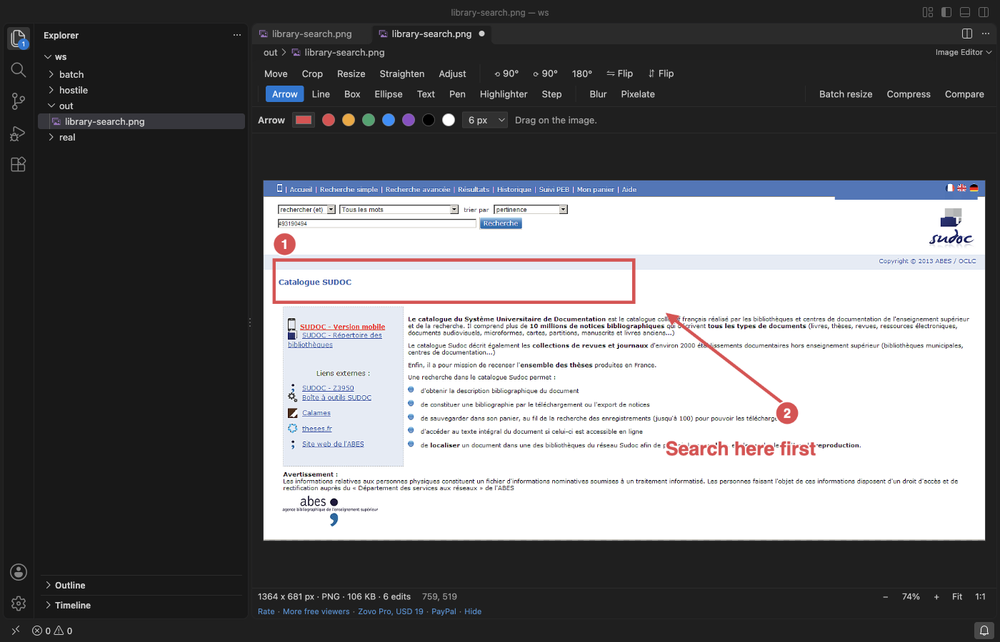
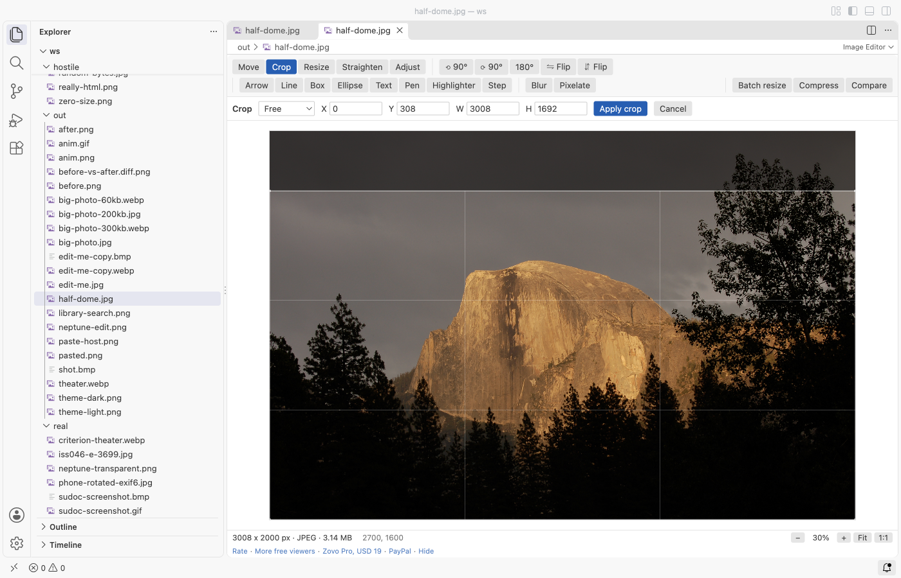
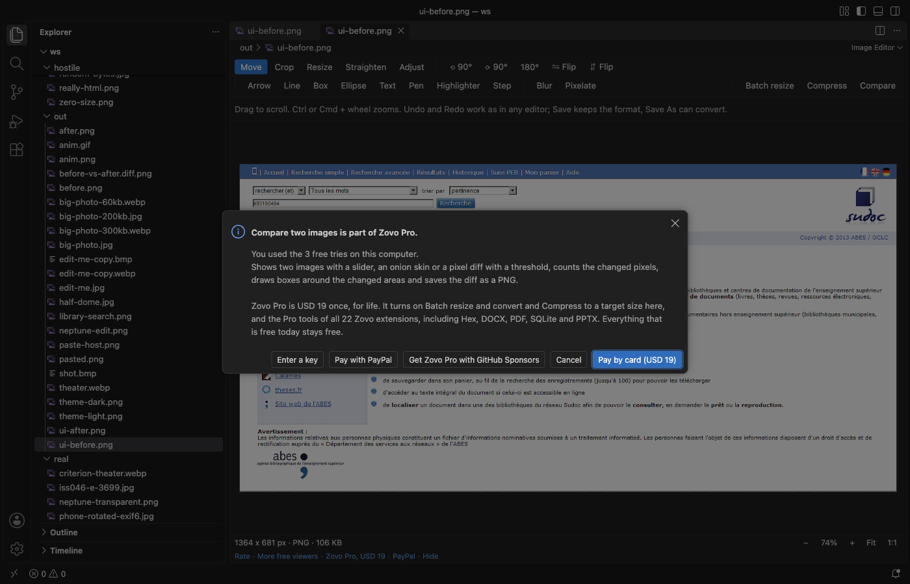

# Image Editor & Image Resizer for VS Code (Crop, Annotate, Convert)

Zovo Pro: USD 19 once, every Zovo tool. Batch resize, Compress to a target size and Compare two images are Pro, with 3 free tries each; editing images stays free.

Crop, resize, rotate, straighten and mark up PNG, JPEG, WebP, GIF and BMP files without leaving VS Code. Add arrows, boxes, text and numbered steps to a screenshot, blur or pixelate what is private, then save it in place or convert it with Save As. Undo, Redo, Save and Revert work as in any VS Code editor. No network, no account.

## Open an image

Images still open in VS Code's own preview, so nothing changes until you ask for the editor:

- Click Edit Image at the top right of the image preview.
- Or right-click a `.png`, `.jpg`, `.jpeg`, `.webp`, `.gif` or `.bmp` file in the Explorer and pick Edit Image.
- Or use Open With... and pick Image Editor. To make it the default for a type, use "Configure default editor" in that list.

## What you can do (free)

| Tool | Details |
|---|---|
| Crop | Free, 1:1, 4:3, 3:2, 16:9, 9:16 or a custom ratio. Drag a box or type X, Y, W and H; Enter applies |
| Resize | Pixels or percent, keep the ratio or not. Downscaling goes in steps for a sharp result |
| Rotate and flip | 90° left or right, 180°, mirror horizontally or vertically |
| Straighten | Any angle from -45° to 45°; the empty corners are cut off |
| Annotate | Arrow, line, box, ellipse, text, pen, highlighter and numbered step badges, in any colour and width. Shift keeps lines at 45° steps and boxes square |
| Blur and pixelate | Drag a box over a password, an email or a face. Saving replaces those pixels in the file, so nothing can be recovered from it |
| Adjust | Brightness, contrast and saturation, with a live preview |
| Zoom and pan | Fit, 1:1, Ctrl or Cmd + wheel, drag to scroll |
| Save and convert | Save keeps the format (JPEG and WebP quality are settings). Save As writes PNG, JPEG, WebP or BMP |
| Paste | Paste an image from the clipboard (Cmd+V or Ctrl+V in the editor) and save it as a new file |

- Photos taken on a phone show the right way up: the EXIF orientation is applied before you edit.
- A GIF opens at its first frame and is saved as a PNG next to it; the GIF itself is not changed.
- Save writes pixels only. EXIF data such as the camera or GPS location is not copied into the saved file.
- Images up to 100 megapixels and 32,767 pixels a side open. Bigger files get a message, not a frozen window.

## Zovo Pro tools

Three tools for bigger jobs, on the toolbar of the editor, in the Command Palette and in the Explorer right-click menu. Each has 3 free tries on your computer; a try counts only when the tool gives you a result (files written, or a comparison on screen). Escape or Cancel never uses one.

- Batch resize and convert: every image in a folder at once. Fit in 1920, 1280 or 800 pixels, a percent or your own size (images are never made bigger), PNG, JPEG or WebP, a quality, and a subfolder or a suffix. Progress, Cancel and a summary with the bytes saved. Originals are never overwritten.
- Compress to a target size: type a size such as 200 KB and the tool finds the highest JPEG or WebP quality that fits, scaling the image down only when even the lowest quality is too big. Metadata is stripped. Before and after are shown side by side. For one image or a whole folder.
- Compare two images: a slider, an onion skin and a pixel diff with a threshold. It counts the changed pixels, draws boxes around the changed areas and saves the diff as a PNG. Useful for UI screenshots before and after a change.

Zovo Pro is USD 19 once and turns on the Pro tools of every Zovo extension. When the free tries are used, the tool shows the ways to pay: by card, GitHub Sponsors or PayPal, or enter a key you already have. Nothing about Pro shows when you open an image. To hide the buttons, set `imageEditor.showProTools` to `false`.

## Safe with any file

- The file type comes from its bytes, not its name: a `.png` that is really an HTML page gets a message and is never shown as a page.
- Cut or damaged files show what could be decoded, or a message. Every size in a header is checked before anything is drawn.
- No network and no telemetry. Images are decoded and encoded inside VS Code; nothing is uploaded.

## Commands

| Command | What it does |
|---|---|
| Image Editor: Edit Image | Open the current or a chosen image in the editor |
| Image Editor: Save a copy as PNG, JPEG, WebP or BMP | Convert the image you are editing |
| Image Editor: Paste an image from the clipboard as a new file | Save a copied screenshot as a file |
| Image Editor: Open a sample screenshot | A made-up app window to try the tools on |
| Image Editor: Batch resize and convert a folder (Pro) | Resize and convert many images |
| Image Editor: Compress to a target size (Pro) | Make images fit a file size |
| Image Editor: Compare two images (Pro) | Slider, onion skin and pixel diff |

## Settings

| Setting | Default | |
|---|---|---|
| `imageEditor.jpegQuality` | `92` | JPEG quality when you save a .jpg file |
| `imageEditor.webpQuality` | `90` | WebP quality when you save a .webp file |
| `imageEditor.showProTools` | `true` | Show the Batch resize, Compress and Compare buttons |
| `imageEditor.showSupportLinks` | `true` | Show the small links at the bottom of the editor |
| `imageEditor.askForRating` | `true` | Ask once, after a few days, whether you want to rate it |

## Limits

- No layers, no brushes with pressure and no animation editing. For painting, a paint program is the better fit.
- GIF animations: only the first frame. TIFF, HEIC, AVIF and SVG files are not opened here.
- The image is held in memory while you edit; very large photos with many edits use a lot of it.

Works in VS Code 1.90 and later, Cursor, Windsurf and VSCodium.

## Support Zovo

Zovo Pro: USD 19 once, every Zovo viewer. [Get Zovo Pro on GitHub Sponsors](https://github.com/sponsors/theluckystrike/sponsorships?tier_id=679878) to turn on the Pro tools in this extension and in the other Zovo extensions you use. The free features stay free.

Zovo extensions have no ads and no tracking. They are made by [theluckystrike](https://github.com/theluckystrike) on GitHub. You can also support the work with no Pro:

- [Sponsor on GitHub](https://github.com/sponsors/theluckystrike)
- [PayPal](https://www.paypal.com/paypalme/najzzz)
- [Follow theluckystrike on GitHub](https://github.com/theluckystrike)

### Need your format supported?

Open a [format request](https://github.com/theluckystrike/image-editor-vscode/issues/new?template=format-request.yml) with a sample file, and I reply there whether it can be done. For USD 299 once, through [this GitHub Sponsors tier](https://github.com/sponsors/theluckystrike/sponsorships?tier_id=679995), I add your file format or a missing feature to this extension, with tests, within 7 days.

## More tools by Zovo

- [Hex Viewer & Binary Viewer, Hex Editor (Large Files)](https://marketplace.visualstudio.com/items?itemName=zovo.zovo-hex-viewer) opens binary files of any size, with find, a data inspector and byte editing.
- [SVN Client & Subversion Source Control (Commit, Blame, Log, Diff)](https://marketplace.visualstudio.com/items?itemName=zovo.zovo-svn-client) brings SVN commit, diff, log and blame to the Source Control view.
- [SVG Preview & SVG Viewer (PNG Export)](https://marketplace.visualstudio.com/items?itemName=zovo.zovo-svg-viewer) previews SVG beside the editor and exports PNG; scripts never run.
- [ZIP Viewer & Archive Explorer (JAR, TAR, GZ)](https://marketplace.visualstudio.com/items?itemName=zovo.zip-archive-explorer) browses ZIP, JAR, VSIX, TAR and GZ files, opens entries in tabs and extracts them safely.
- [Font Viewer, TTF Viewer, OTF & WOFF Viewer, Font Preview](https://marketplace.visualstudio.com/items?itemName=zovo.font-viewer-vscode) opens TTF, OTF and WOFF fonts with a glyph grid and a type tester.

See [all Zovo extensions on the Marketplace](https://marketplace.visualstudio.com/publishers/zovo).
